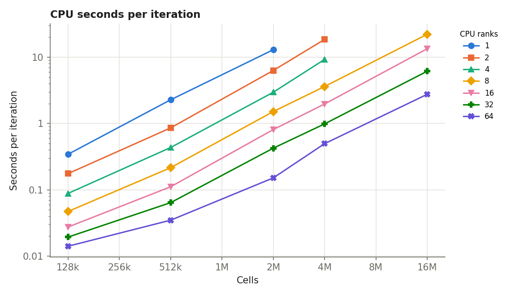
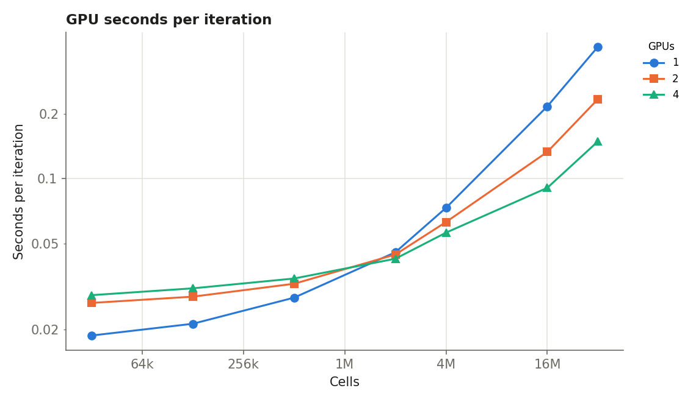

# GUST

[](https://github.com/erf-model/gust-abl/actions/workflows/ci.yml)
[](https://github.com/erf-model/gust-abl/actions/workflows/docs.yml)

**GUST** (Grid-sequenced Unified Steady Terrain solver) computes steady wind fields over complex terrain. It is a
steady Reynolds-averaged Navier–Stokes (RANS) solver for the atmospheric boundary layer, built on
[AMReX](https://github.com/AMReX-Codes/amrex), and one code base builds for CPUs and GPUs (CUDA, HIP, SYCL).
The same code also runs unsteady RANS, for flows that have no steady state.

## What it does

- **Two answers from one input file.** A mass-consistent wind in seconds (stop after the initializer), or the
  converged steady RANS solution in minutes.
- **Steady solver.** SIMPLEC pressure–velocity coupling with implicit vertical line relaxation (line LU-SGS),
  local pseudo-time stepping with switched-evolution relaxation, and grid sequencing over coarser horizontal
  levels. An optional Jacobian-free Newton–Krylov stage (`steady.stage = simplec_newton`) finishes to tight
  tolerances.
- **Unsteady solver.** `steady.stage = unsteady` marches physical time in backward-Euler (BDF1) steps by dual
  time stepping: each step is converged by the same SIMPLEC pseudo-time iteration. It keeps running means and
  variances, writes probe time series, and restarts from a steady or an unsteady checkpoint.
- **Physics.** The Axell–Liungman k–L turbulence closure (or laminar flow), a Monin–Obukhov surface layer,
  buoyancy, Coriolis, and inflow from a log law or a measured profile.
- **Forest canopies and buildings.** Canopy drag, turbulence and heat from a leaf-area-density field. Buildings
  from a height map by immersed forcing with a wall law, and the force on them.
- **Nests.** Finer meshes (refinement 2 2 1) inside the domain, named in the same input file by their corners.
  One-way by default; four two-way options feed the nests back to the outer domain.
- **Terrain.** A terrain-following mesh from an elevation file (`x y z` points or ERF's grid format), with
  stretched vertical layers for thin near-ground cells. The pressure equation uses a terrain-aware multigrid
  solver that handles high cell aspect ratios. An immersed ground on a flat mesh
  (`terrain.representation = immersed_forcing`) is available for flat ground only so far.
- **A clear definition of steady.** Residuals must fall by a set number of orders and the monitored quantities
  must settle; the run says why it stopped. Restarts continue bit for bit on the same ranks and box layout.

GUST reuses components of [ERF](https://github.com/erf-model/ERF) (the k–L closure, the terrain-following mesh and
Poisson operator, the surface layer), and its initializer builds on
[FastWindTerrain](https://github.com/hgopalan/FastWindTerrain). It was called ablsteady before October 2026.

## Quick start

```bash
git clone --recursive https://github.com/erf-model/gust-abl.git
cd gust-abl
cmake -S . -B build-rel -DCMAKE_BUILD_TYPE=Release
cmake --build build-rel -j 8
ctest --test-dir build-rel -L unit --output-on-failure
mpirun -n 2 build-rel/gust Tests/Infrastructure/Smoke_Restart/inputs_smoke
```

The [tutorials](https://erf-model.github.io/gust-abl/) walk through a single column, a flat boundary layer, a hill
and Askervein Hill.

## Case set-up tools

Python scripts in [`tools/`](tools/) set up and check a case without editing decks by hand
(`pip install numpy pyyaml`; the window also needs `PySide6 pyqtgraph`):

| Script | What it does |
|---|---|
| `make_gust_case.py case.yaml` | writes a case folder (decks, terrain, `run.sh`) from one short YAML description |
| `make_gust_library.py build CASE_DIR` | turns a sweep's finished runs into a wind library; `query` blends it for any direction and speed |
| `check_gust_inputs.py inputs` | checks a deck: unknown keys, ranges, settings that do not go together |
| `fetch_terrain.py case.yaml` | downloads SRTM-based elevation tiles (AWS Terrain Tiles) for the case's domain |
| `gust_gui.py [case.yaml]` | a window over the three: a form that starts with the basic settings (every key on request), a map of the domain and nests, the checker's findings, and a Run button that plots the residuals |

```bash
python3 tools/gust_gui.py Tests/Infrastructure/Case_Setup/flat_nest.yaml
```

The [case set-up page](https://erf-model.github.io/gust-abl/case_setup.html) describes the YAML keys, the window
and the terrain data and its acknowledgements.

## Platforms

| Platform | Status in CI |
|---|---|
| Linux CPU (GCC Release and Debug, Clang; MPI) | built, unit and smoke tests run |
| Windows CPU (MSVC, serial) | built, unit and smoke tests run |
| Single precision (Linux) | compiled |
| NVIDIA CUDA sm_90 (Linux, Windows) | compiled |
| AMD HIP gfx90a (Linux) | compiled |
| Intel SYCL (Linux) | compiled |

Hosted CI runners have no GPUs, so the GPU builds are compiled but not yet run (see the
[CI page](https://erf-model.github.io/gust-abl/ci.html)).

## Performance

Seconds per iteration on a Kestrel CPU node (104 Intel Xeon Sapphire Rapids cores) and on a Kestrel GPU node
(4 × NVIDIA H100), the 3-D hill on power-of-2 meshes (GUST 12a81339f). The analysis, the minimum cells per rank
and per GPU and the full tables are in the [scaling page](https://erf-model.github.io/gust-abl/scaling.html) of
the documentation.





## Documentation

The full documentation is at <https://erf-model.github.io/gust-abl/>: building and running, every input with its
range, the governing equations, discretization and solution algorithm (steady and unsteady), canopies, buildings
and nests, test cases and results. The sources are
in [`docs/`](docs/), and the same pages as one PDF at <https://erf-model.github.io/gust-abl/gust.pdf>. To
build them locally:

```bash
python3 -m pip install -r docs/requirements.txt
make -C docs html     # output in docs/_build/html
```

## Contributing

Issues and pull requests are welcome. The development rules (tests, input checks, review) are in
[`docs/development.rst`](docs/development.rst).

## Licence

BSD 2-Clause ([`LICENSE`](LICENSE)). Code copied from ERF keeps ERF's licence; see
[`docs/extraction.rst`](docs/extraction.rst).
