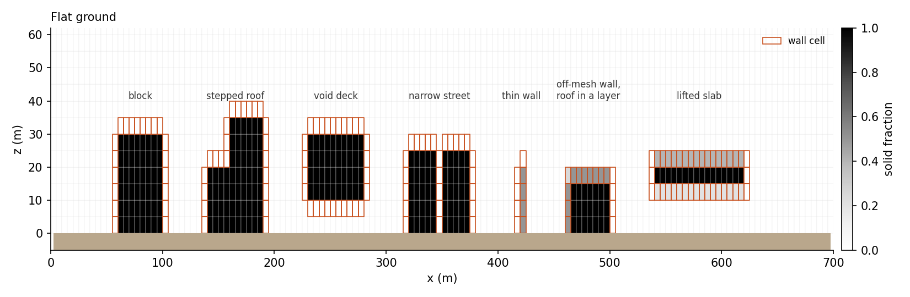
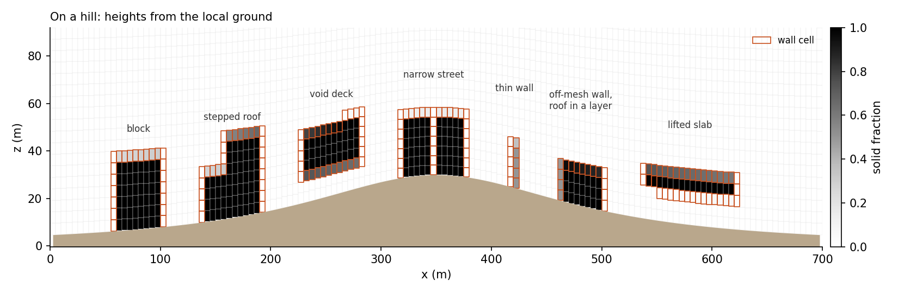
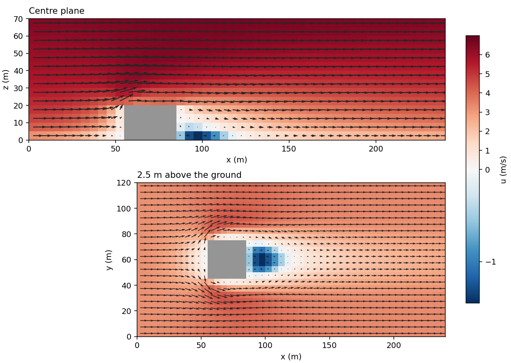
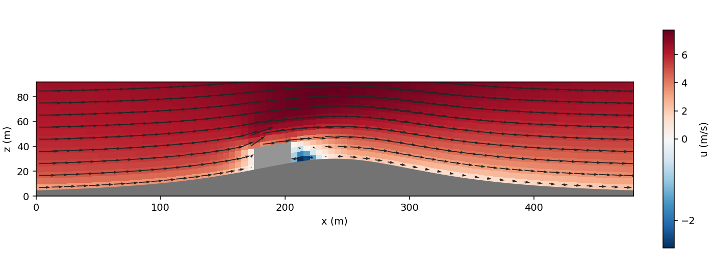
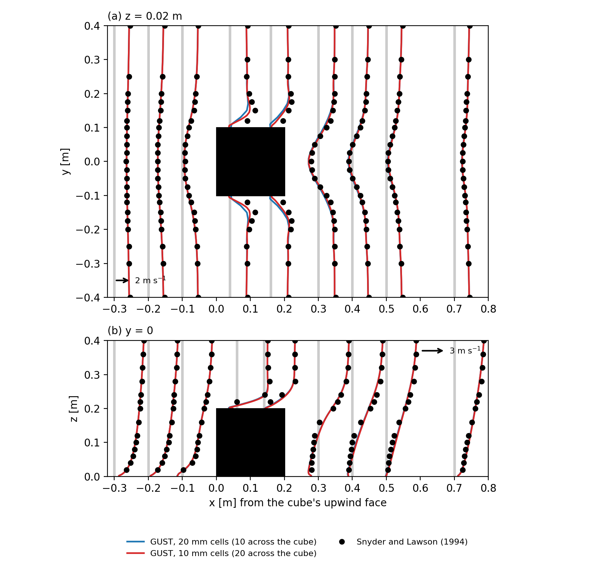
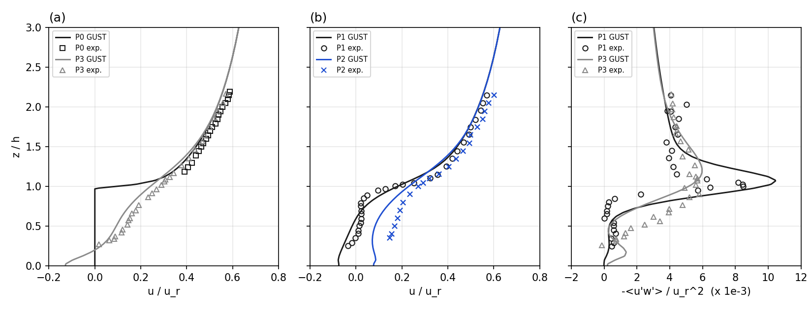

Buildings
=========

Buildings on the terrain shape the wind where it enters the wildland–urban interface. GUST represents them by
immersed forcing with the form 7 wall law of ERF (``erf.if_wall_form = fraction_stress``) and Kynema-SGF
(``wall_form 7``). The ground keeps its body-fitted wall law on the terrain-following mesh and is not blanked.

**Status.** The geometry acts on momentum with SIMPLEC and z-line sweeps on one level (`Momentum`_). Roofs,
undersides and sides have the wall law, and the closure sees the buildings (`Turbulence`_): :math:`k` has its wall
value beside them and the length scale their distance. :math:`\theta` exchanges heat with the walls at a given wall
temperature (`Temperature`_). Answers near buildings are not validated. The run refuses
``steady.stage = simplec_newton``, ``steady.sweep = lusgs``, ``mesh.hierarchy_levels`` above 1 and
``solver.poisson_backend = mlmg``, and fluid sealed off by buildings.

Height map
----------

``buildings.file`` holds heights above the local ground on a rectangular grid of points, in one of two layouts
(``buildings.format``):

- ``erf``: ERF's ``erf.buildings_file_name``: ``nx``, ``ny``, the ``nx`` x values, the ``ny`` y values, then the
  ``nx ny`` heights, x the slow index.
- ``xyz``: ``x y height`` or ``x y height zstart`` lines holding every grid point once, in any order, comma or
  white-space separated, ``#`` comments allowed. Scattered points are refused, as interpolating them would smear the
  walls. The building is solid from ``zstart`` (default 0) up to ``height``, so ``zstart > 0`` leaves an open void deck
  under it. ``height`` is the top of the building, not its thickness.

Over terrain, ``height`` and ``zstart`` are measured from the ground of each column.

Each point owns a tile reaching halfway to its neighbours, the end tiles as far outward as inward. The height is
constant over a tile and 0 outside the tiles, so a wall lies on a tile edge and is vertical. In a periodic direction
the tiles wrap, and a file listing both ``x = 0`` and ``x = L`` is refused.

ERF interpolates the same points to the cell corners, which makes a ramp over a cell on the edge of a cube. With points
at every cell node, that column holds the same volume as here, in other layers; other point spacings can differ in
volume too.

Solid fractions
---------------

With :math:`h` the tile's height, :math:`z_s` its ``zstart`` and :math:`z_b, z_t` a cell's lower and upper heights above the ground of its column
(four-corner means, as in ``detJ``), the solid fraction :math:`\beta` is the exact mean over the cell's footprint
:math:`A`,

.. math::

   \beta = \frac{1}{|A|} \int_A \frac{\max\bigl(0, \min(h, z_t) - \max(z_s, z_b)\bigr)}{z_t - z_b}\, dA.

So a building follows the ground: on a slope its roof is parallel to the terrain. ``buildings.small_volfrac`` then
sets a fraction below it to 0 and one within it of 1 to 1. A cell is fluid at :math:`\beta = 0`, solid at
:math:`\beta = 1` and partial otherwise.

A vertical face takes the same mean along it, with its two-node mean heights; on a tile edge the taller tile counts. A
horizontal face takes the part of its area inside a building or at its roof or underside. A face touching a solid cell then has
fraction 1 and one between two fluid cells 0.

Wall cells
----------

The difference between the blocked fractions of a cell's opposite faces is the wall area in the cell facing that way,
and in a fluid cell any blocked face is a wall. Along z this gives ERF's ``ib_wall::is_wall_cell``: a partial cell with
fluid above it, or a fluid cell on a solid one. The plotfile's ``building_wall`` holds the sum of the bits of the walls of a cell:

.. list-table::
   :header-rows: 1
   :widths: 10 90

   * - Bit
     - Wall
   * - 1
     - Roof below the cell
   * - 2, 4
     - Side at the cell's low, high x
   * - 8, 16
     - Side at the cell's low, high y
   * - 32
     - Underside of a lifted building above the cell

A roof and a side make an edge cell, and two sides a corner. Along a normal with a wall, with :math:`\Delta_n` the
cell's size along it (:math:`\Delta x`, :math:`\Delta y`, or its height) and :math:`\Delta_r` that of the reference cell,
the next one out, the fluid centroid and the reference cell lie at

.. math::

   d_1 = \tfrac{1}{2}(1 - \beta)\,\Delta_n, \qquad d_2 = (1 - \beta)\,\Delta_n + \tfrac{1}{2}\Delta_r

from the wall; on equal layers :math:`d_2 = (\tfrac{3}{2} - \beta)\Delta_n`, as in ERF. :math:`d_2` is 0 when the reference
cell is solid or outside the domain, such as across a one-cell street or under a building in the lowest layer.

Kinds of building
-----------------

The figures show ``building_beta`` from GUST on a slice along x, with 5 m cells, wall cells outlined
(``Tests/Infrastructure/Building_Field/plot_building_kinds.py``). On the hill the same map follows the ground.

   Building kinds on flat ground.

   The same map on a 30 m hill.

Momentum
--------

**Fixed rows.** A face with fraction 1 has :math:`u = 0`. Its residual is the velocity, its implicit row the identity,
with no :math:`1/\Delta\tau`, and the SIMPLEC denominator is zero. This is the steady limit of ERF's
``if_implicit_projection``. No drag coefficient enters, so the answer does not depend on one.

The ground's ``w`` stays the boundary conditions' row under a building too, as they set it from the terrain's slope.

**Mass fluxes.** A partial face's flux is scaled by its open fraction :math:`1 - \beta_f`. The metric itself is unchanged,
as the pressure gradient reads it.

**Pressure correction.** Blocked faces have zero area, a solid cell's row is :math:`\phi = 0`, and the mean of the singular
problem is over the fluid cells. GMRES runs on ERF's operator. Its FFT or multigrid preconditioner keeps every face
and does not know the mask, so the number of iterations grows with buildings (8 for one, 11 for nine, 3 for none, on the
test's mesh with ``gmres_mlmg``). Under multigrid GMRES is flexible, as the cycle's bottom solver is not a fixed
linear map. Fluid with no open path to the rest has its own null vector, so the run refuses it.

**Wall law** (``buildings.wall_form = fraction_stress``). A wall cell has, neutrally, for each of its walls,

.. math::

   u_*^2 = (1 - \beta) u_{*,\mathrm{own}}^2 + \beta u_{*,\mathrm{ref}}^2, \qquad
   u_{*,x} = \frac{\kappa U_x}{\ln(\max(d_x, 10 z_0) / z_0)},

with :math:`\kappa = 0.41`, :math:`z_0` = ``buildings.z0``, :math:`d_x` the distances :math:`d_1` (own) and :math:`d_2`
(reference) along the wall's normal, :math:`U` the speed parallel to the wall in the cell (own) and in the next one out
(reference), and :math:`u_*^2 = u_{*,\mathrm{own}}^2` where :math:`d_2 = 0`. The speed is taken at the cell centre from the
two components parallel to the wall, each the mean of the cell's two faces that are not fixed rows
(``buildings.wall_speed = open_faces``, below):

.. list-table::
   :header-rows: 1
   :widths: 34 22 22 22

   * - Wall
     - Normal
     - Parallel components
     - :math:`\Delta_n`
   * - Roof, underside
     - z
     - :math:`u, v`
     - the layer's height
   * - Side at low or high x
     - x
     - :math:`v, w`
     - :math:`\Delta x`
   * - Side at low or high y
     - y
     - :math:`u, w`
     - :math:`\Delta y`

The wall is a sink on each parallel component :math:`u_t`,

.. math::

   S = -r u_t, \qquad r = \frac{f\, u_*^2}{\Delta_n \max(|U_\mathrm{own}|, 10^{-3}\ \mathrm{m/s})},

with :math:`\Delta_n` the cell's size along the normal and :math:`f` the wall's part of its face's area: in a fluid cell
the blocked part of the face the wall lies on, and in a partly solid cell the difference between the blocked parts of
that face and of the opposite one, which is the area facing that way. The force on the cell is then the stress
:math:`u_*^2` on the wall's area, along the flow parallel to it.

On a slope the solid fraction of a roof's cells changes a little from column to column, so each carries a side bit
(`Wall cells`_) with a small such area, 0.03 of the face on the block of the ridge below. Until this was taken as the
area, the side's rate used the whole face's blocked part there, about 0.7, which is the building's own cross-section.

**Edges and corners.** A cell with several walls takes the sum of their rates on each component: at an edge between a
roof and a side normal to x, :math:`u` has the roof's rate, :math:`w` the side's, and :math:`v`, which runs along the edge,
both. At a corner between two sides :math:`w` has both. Each wall uses its own parallel speed and its own distances.

**Speed in a cell with two walls** (``buildings.wall_speed``). In an edge or corner cell one of the two faces of a
velocity component can lie on the other wall, where the velocity is fixed at 0. With ``open_faces``, the default with
``fraction_stress``, a component is the mean of the faces that are not fixed rows, in the cell and in its reference
cell: the open face's value where the other is fixed, and 0 where both are. A fixed row is a face with blocked
fraction 1; ``w`` on the ground is not one, as the boundary conditions set it from the slope. The mean with the zero would halve the speed and, with the flow normal to the
other wall, halve that cell's part of the stress on the open face's row; ERF, which evaluates the law at each velocity
face from that face's own value, has the full part, and so has ``open_faces``. Neither is exact. If the component
falls linearly from the open face's value :math:`u_o` to 0 at the other wall, the law's stress averaged over the cell is
:math:`\tfrac{1}{3} C u_o^2` (:math:`C = \kappa^2 / \ln^2`): the mean with the zero gives :math:`\tfrac{1}{4}` on the open
face's row (25 % low), and ``open_faces`` and ERF give :math:`\tfrac{1}{2}` (50 % high). The wall value of :math:`k`
(`Turbulence`_) reads the cell's :math:`u_*^2` with no row average, so there ``open_faces`` gives 3 times that mean
and the mean with the zero 0.75 times. On the other parallel component's row ERF takes a four-point mean that
includes the fixed faces, so ``open_faces`` is above it there. A cell with no fixed face among those of
its parallel components (a plain roof or side cell) is not affected. ``all_faces`` takes the mean of both faces, as
before; it is the default with ``roof_stress``, which also accepts ``open_faces`` (the roofs' speed then skips the
sides' fixed faces). A checkpoint written before this choice restarts with ``all_faces`` and is refused with
``open_faces``, so a ``fraction_stress`` deck that continues such a run has to name ``all_faces`` (and
``buildings.wall_tke = off`` and ``buildings.theta_mode = none``, for the same reason: `Turbulence`_, `Temperature`_).

On the courtyard of ``Tests/Canonical_RANS/Building_Courtyard``, :math:`k` in an inner corner's wall cell is 0.023 m²/s²
with ``open_faces`` and 0.008 m²/s² with ``all_faces``, and the velocities differ by about 0.02 m/s at most. One block on
flat ground has no such cell and keeps its answer to the last bit. On the ridge the two forms agree to 0.0001 m/s; the
change there, up to 0.006 m/s, comes from the wall's area above.

A velocity row takes the mean :math:`r` of its two cells. The viscous flux of a parallel component through the blocked
part of a wall's face is closed, in the residual and in the implicit rows, and :math:`r` goes into :math:`a_P`, not into
the local pseudo-time step.

``buildings.wall_form = roof_stress`` applies the law to roofs and undersides alone: the sides keep their fixed rows,
with viscous fluxes to the zero velocity. This is what ``fraction_stress`` did before the sides had the law; on the two
test cases it gives that form's plotfiles bit for bit. A checkpoint written with that earlier ``fraction_stress``
restarts with ``roof_stress`` and is refused with today's ``fraction_stress``, whose answer differs. ``buildings.wall_form = drag`` keeps the fixed rows alone on every wall, as Kynema-SGF's laminar pathway.

   One block in a log-law wind (``Tests/Canonical_RANS/Building_Cube``), with the fixed rows, the wall law on the roof
   and the sides, and the closure's building terms. This shows the method working, not a validated flow.

   The same block on a ridge's windward flank (``Tests/Canonical_RANS/Building_Hill``), with its floor and roof following
   the ground. The same limits apply.

Turbulence
----------

With ``buildings.wall_tke = on``, the default with ``buildings.wall_form = fraction_stress``, the :math:`k`–:math:`L`
closure (:doc:`turbulence_model`) sees the buildings in four ways.

**Solid cells** hold :math:`k` at the closure's floor (``turb.tke_floor``): their row is :math:`R_k = k - k_\mathrm{floor}`.

**Wall cells** relax :math:`k` to the wall value of the law's friction velocity, as the ground's first cell does:

.. math::

   W = a\,(k - k_w), \qquad k_w = \max\!\left(\frac{u_*^2}{C_{\mu 0}^2},\, k_\mathrm{floor}\right), \qquad
   a = \frac{\max(u_*, 0.01\ \mathrm{m/s})}{d_w},

with :math:`u_*^2` the largest of the cell's walls, :math:`C_{\mu 0}` = ``turb.Cmu0`` and :math:`d_w` the wall cell's
:math:`d_b` below. :math:`k_w` is the value at which the closure's production equals its dissipation in a log layer
with that :math:`u_*`, the one the ground uses. How :math:`W` enters follows the ground's choice ``bc.surface_wall_k``,
with :math:`f` the largest blocked part of the faces the cell's walls lie on:

.. list-table::
   :header-rows: 1
   :widths: 30 70

   * - ``bc.surface_wall_k``
     - Wall cell's row
   * - ``dirichlet`` (default)
     - :math:`R_k \leftarrow (1 - f) R_k + f W`: a fully blocked face replaces the cell's :math:`k` equation, and a
       slightly blocked one leaves it nearly as it was. In the ground's first cell, which has the ground's own
       relaxation row, :math:`f W` is added to that row, so :math:`k` settles between the two wall values.
   * - ``source``
     - :math:`R_k \leftarrow R_k + f W` in every wall cell, as the ground adds its own.
   * - no surface layer
     - As ``dirichlet``, without the ground's row.

**Fluxes.** The diffusive flux of :math:`k` through the blocked part of a face is closed, in the residual and in the
implicit rows: :math:`k` does not diffuse into a building.

**Length scale.** The closure's geometric length :math:`l_g = \kappa (d + z_0)` takes the nearer of the ground and the
nearest wall of a building, each with its own roughness:

.. math::

   d + z_0 = \min(d_\mathrm{ground} + z_{0,g},\; d_b + z_{0,b}),

with :math:`z_{0,g}` the ground's roughness of the column (``bc.surface_z0`` or its map; 0 without a surface layer) and
:math:`z_{0,b}` = ``buildings.z0``. In a wall cell far above the ground this is the log law's
:math:`\kappa (d_b + z_{0,b})`, whatever the ground's roughness. ``turb.max_geom_lscale`` still caps the length. The
closure adds :math:`z_{0,g}` to the distance it is given, so the stored distance is
:math:`\min(d_\mathrm{ground}, d_b + z_{0,b} - z_{0,g})`: the turbulence plotfile's ``walldist`` shows this value, which is
:math:`\min(d_\mathrm{ground}, d_b)` where the two roughnesses are equal and can be below zero beside a wall on ground
much rougher than the wall. The hybrid convection blend (``convection.hybrid_height``) keeps the ground's distance.
:math:`d_b` is

- in a wall cell, the distance of its fluid centroid from its nearest wall, :math:`\tfrac{1}{2}(1 - \beta)\Delta_n`,
  not below ``buildings.z0``;
- elsewhere, the distance from the cell centre to the nearest wall of a building. Each wall is a rectangle on its
  plane, placed from the cell's solid fraction and the blocked parts :math:`f_\mathrm{wall}` and
  :math:`f_\mathrm{opp}` of the face the wall is on and of the opposite one. The solid of the cell is the part that
  runs through to the opposite face and the wall's own part, which reaches a depth :math:`\delta` of the cell's size
  in from the wall's face:

  .. math::

     \beta = f_\mathrm{opp} + (f_\mathrm{wall} - f_\mathrm{opp})\,\delta, \qquad
     \delta = \frac{\beta - f_\mathrm{opp}}{f_\mathrm{wall} - f_\mathrm{opp}} \in [0, 1],

  and 0 in a fluid cell. A roof over a slab is :math:`\beta \Delta_z` above the cell's floor. The side of a
  neighbouring solid cell lies on the face (:math:`\delta = 0`), also where a roof fills part of the same cell: the
  tower's side above a podium. A building's edge inside a cell is :math:`\delta \Delta_x` in. The relation is exact
  where the wall's own part has one depth in the cell, which a building made of tiles has except where two edges
  along the same direction cross one cell. Over its plane a side
  covers the blocked part of its face's height; a roof covers its cell's footprint, or the blocked part of it from
  the cell's side wall where the building's edge lies inside the cell. In the corner of a block inside a cell, each
  wall covers the block's face. A wall on the face of a fluid cell is the outer face of the solid in the cell across
  it: where that cell is partly solid and holds one block (the product of its walls' depths along the face equals the
  face's blocked part), the rectangle is the block's cross-section, so a roof ends at the building's edge and a side
  at its corner.

The distance is found once, at start-up, by passing each cell's nearest wall to its 26 neighbours until no distance
falls (a vector distance transform). The log gives the number of passes and of cells whose length a building's wall
sets. For one block it equals the distance to the block's box to round-off, and so it does, against the smallest
distance over the boxes, for an L with a step, for a tower on a podium that ends inside a layer, and for a block
whose sides and top lie inside cells (the unit tests' shapes).

**Residual norm.** The solid cells' rows, :math:`k - k_\mathrm{floor}`, are no part of the flow. They count as zeros
in the scaled norm of :math:`k` and in the count of ``steady.confidence``; the number of points of the norm stays the
mesh's. The wall cells' rows stay in the norm, as the ground's first cells do. From a first guess with :math:`k` well
above the floor inside a building the norm's reference, its largest value over the first iterations, is then that of
the flow (0.2 on the block, against 4.0 with the solid rows), so the relative residual of :math:`k` is larger and the
stop on it stricter than with those rows. A checkpoint written with them keeps its reference: a restart from it
stops on :math:`k` as that run would have, and reads the lengths and distances of this page.

**Lee options near buildings.** The eddy-viscosity cap (``turb.realizability``, :ref:`nut-cap`) and the upwind
blend that follows it (:ref:`hybrid-convection`) let a smooth hill's lee separate: the default closure keeps the
shear layer leaving a crest too mixed, and the flow stays attached. A building's sharp edges fix where its flow
separates, so the cap's case does not carry over: there it changes how the separated layers mix, for better in
some places and for worse in others. On the cube of `Validation`_ (20 mm cells), without the zone below
(``buildings.limiter_zone = 0``), the cap gives the roof the bubble the measurements show, but the bubble on the
floor behind reaches 1.88 H (1.34 H plain, 1.36 H measured), the near wake's shear layer and the far wake are too
slow, and the horseshoe vortex ahead of the cube grows; the rms difference from the measurements goes from 0.244 to
0.319 m/s. ``buildings.limiter_zone`` :math:`= c` (default 3) fades the cap out around each building with a
weight :math:`w` that divides it, :math:`\nu_t \le C_r k / (S\,w)`:

.. math::

   w = \begin{cases} 0, & s \le \tfrac{1}{2} \\ t^2 (3 - 2t), \; t = 2s - 1, & \tfrac{1}{2} < s < 1 \\ 1, & s \ge 1 \end{cases}
   \qquad s = \frac{d_b}{c\,H_b},

with :math:`d_b` the distance to the nearest building wall (above) and :math:`H_b` the height of that wall's
building, the tallest solid column next to the wall's cell (the solid thickness of a lifted building). The cap is
lifted within :math:`c H_b / 2` of a building and back in full beyond :math:`c H_b`. The blend grows only where the
cap holds :math:`\nu_t`: it is off where the cap is lifted and reduced in the band where :math:`w` rises. Away from buildings the options act as before, so on a site with
buildings on terrain a hill's lee keeps them. The zone needs ``buildings.wall_tke = on`` (it reads :math:`d_b`) and acts
only with ``turb.realizability`` > 0; the log gives the cells where it lifts the cap and where it fades. With it the
cube's answer is the plain closure's within 0.001 m/s and 0.001 m (reattachment 1.35 H, rms 0.244 m/s). ``0`` keeps the cap
everywhere, as before. The default rests on the cube's overall agreement; 3 is about the smallest size that keeps
the cap off over its measured bubble. The weight is a geometric switch, not a detector of separation: a building in a
hill's lee, or a building's wake longer than :math:`c H_b` (a wake grows with the building's width more than its
height), gets the plain closure or the cap by its distance alone. A checkpoint
written with the cap and without the zone restarts with ``buildings.limiter_zone = 0``; one written with the zone
restarts only with the same ``buildings.limiter_zone`` and ``turb.realizability`` > 0. The default changes the answer of
a run with buildings and ``turb.realizability`` > 0 written before it; no deck of the tests has that pair.

``buildings.wall_tke = off`` leaves the closure as it was before these terms: :math:`k` is solved in every cell with
the ground's distance alone. A checkpoint written before them restarts with ``off``, together with ``buildings.wall_speed = all_faces``
(`Momentum`_) and ``buildings.theta_mode = none`` (`Temperature`_), and is refused with ``on``. ``on``
needs the wall law on every wall, so it is refused with ``roof_stress`` and ``drag``.

On the block of the first figure, :math:`k` in the roof's wall cell is 0.41 m²/s² with these terms and 8.6 m²/s²
without, against 0.35 m²/s² upstream at that height, and without them :math:`k` in the solid cells was 3 m²/s². On the
ridge of the second figure the air now reverses in a thin layer on the roof (u in the roof's wall cell -0.17 m/s; it was
3.90 m/s), as the eddy viscosity there is lower.

Temperature
-----------

``buildings.theta_mode`` selects how :math:`\theta` meets a building, with the form 7 treatment for a given surface
temperature :math:`\theta_b` (ERF ``ib_wall::wall_state``, ``surface_temp``), neutral. It needs the wall law on every
wall (``buildings.wall_form = fraction_stress``) and is ``ambient`` by default with it.

**Solid cells** hold :math:`\theta = \theta_b`: the row is :math:`R_\theta = \theta - \theta_b`, an identity row, as
those of :math:`k`.

**Wall cells.** Each wall takes heat from the air of its cell at the kinematic flux

.. math::

   q = u_*\,\theta_*, \qquad
   \theta_* = (1 - \beta)\,\frac{\kappa\,(\theta - \theta_b)}{\ln(d_1 / z_0)}
            + \beta\,\frac{\kappa\,(\theta_\mathrm{ref} - \theta_b)}{\ln(d_2 / z_0)},

with :math:`u_*` the momentum law's friction velocity of that wall (`Momentum`_), :math:`d_1` and :math:`d_2` its two
distances with the same floor of :math:`10 z_0`, :math:`z_0` = ``buildings.z0``, :math:`\theta` the cell's and
:math:`\theta_\mathrm{ref}` the reference cell's (the next one out along the wall's normal), and the own term alone,
without its factor :math:`1 - \beta`, where there is no reference cell. :math:`q > 0` cools the air. Over the cell,

.. math::

   R_\theta \mathrel{+}= \sum_\mathrm{walls} \frac{f\,q}{\Delta_n},

with :math:`f` the wall's part of its face's area and :math:`\Delta_n` the cell's size along its normal, as for the
stress. The coefficient on the cell's own :math:`\theta` goes into :math:`a_P`; the reference cell's part is in the
residual alone. There are no stability functions: the exchange does not feel the temperature difference it makes.
With no wind along a wall :math:`u_*` is zero and so is the exchange.

**No conduction.** The diffusive flux of :math:`\theta` through the blocked part of a face is closed, in the residual
and in the implicit rows, as that of :math:`k`. The wall's flux above is the whole exchange.

**The walls' temperature.**

- ``ambient``: :math:`\theta_b` is the reference profile (``bc.theta_profile``) at the cell's height, and each cell's
  :math:`\theta` is compared with its own height's, the reference cell's too. A state at the profile exchanges no
  heat, so a neutral run stays neutral; where :math:`\theta` leaves the profile the walls pull it back.
- ``fixed``: :math:`\theta_b` = ``buildings.theta_surface`` (K) on every wall. Warm walls heat the air beside them,
  and with gravity on that air is buoyant, so the flow near the building is no longer neutral.
- ``none``: :math:`\theta` as before these terms: solved in every cell, with diffusion through the buildings' faces.

The log gives the heat the walls take from the air at the end of the run, the sum of :math:`f q` times the walls'
area (K m³/s; negative when they heat it; with ``ambient`` in a neutral run it is zero but for the small drift of
:math:`\theta` from the profile during the iteration, 1e-4 K m³/s on the block). On the block of the first figure with walls 5 K above the air and gravity
on, the run stops in 105 iterations, the walls give 585 K m³/s, and the heat carried through the planes downstream,
:math:`\sum u\,(\theta - 300\ \mathrm{K})\,\Delta y\,\Delta z`, is 583 K m³/s. The air is at most 1.07 K above the
inflow.

The solid cells' rows are left out of the residual norm of :math:`\theta` and of the count of ``steady.confidence``,
as those of :math:`k` (`Turbulence`_). With ``simplec.theta = frozen`` :math:`\theta` is data and these terms do not
act; the key is then refused when given as ``ambient`` or ``fixed`` (frozen :math:`\theta` needs grid sequencing,
which buildings do not have yet, so the two do not meet today). On the three building cases of the tests, which are
neutral with gravity off, ``ambient`` and ``none`` give the same velocities and :math:`k` bit for bit in the same
number of iterations; :math:`\theta` differs by up to 0.007 K, its drift from 300 K without these terms. A checkpoint written before these terms
restarts with ``buildings.theta_mode = none`` and is refused with the others; ``buildings.theta_surface`` is part of
what a restart must keep.

Validation
----------

The flow around a cube (H = 0.2 m) in a wind-tunnel boundary layer, against the measurements of Snyder and Lawson
(1994) in the U.S. EPA Fluid Modeling Facility, as Wise et al. (2026, Appendix A) set it up to validate ERF's immersed
forcing (``Tests/Canonical_RANS/Snyder_Lawson_Cube``): the mean streamwise velocity on the plane z = 0.1 H and on
the centre plane, upwind of, over, beside and behind the cube, 296 values digitized from the preprint's figures.
GUST solves the steady RANS equations, the paper time-averages LES.

   Mean u around the cube, (a) at z = 0.02 m and (b) on the centre plane, drawn from each station's grey line as
   x + 0.025 u: the measurements (dots) and GUST's plain closure with 20 mm and 10 mm cells across (10 and 20 across
   the cube) and 5 mm layers to 0.3 m.

With 20 mm cells the rms difference from the measurements is 0.244 m/s and 88 % of the values are within 25 % or
0.1 m/s; the reattachment behind the cube is 1.34 H, against 1.33 to 1.36 H measured. With 10 mm cells (20 across) the rms difference is 0.216 m/s, the hit rate 0.905 and
the reattachment 1.29 H: the error over and beside the cube falls, and the reattachment is not grid-converged. The largest
differences are beside the cube, where the measured flow speeds up past the side edges, over the roof, where the
plain closure has no bubble 0.1 H above it, and in the strength of the reversed flow near the floor behind the cube
(-1.15 m/s against -0.80 m/s at x = 1.5 H). The
case README has the set-up, the regions and the closure options compared.

The measurements are those of W. H. Snyder and R. E. Lawson (1994); the values are digitized from Figs. A3 and A4 of
Wise et al. (2026, https://doi.org/10.5194/egusphere-2026-4030, CC BY 4.0). We thank them, and the EPA Fluid Modeling
Facility.

The flow over a staggered array of cubes (h = 20 mm, 25 % plan area), against the measurements of Castro et al.
(2006) in the EnFlo tunnel, as Muñoz-Esparza et al. (2020, section 3) set it up to validate FastEddy's immersed body
force (``Tests/Canonical_RANS/Castro_Cube_Array``): one 4h x 4h tile, periodic in x and y, 10h deep, driven by a
constant pressure gradient F = u_τ²/L_z from the tunnel's u_τ = 0.7 m/s, with 2 mm cells across (10 across a cube).
Profiles of u above a cube (P0), one h behind it (P1), beside it (P2) and behind and beside it (P3), and of -<u'w'>
at P1 and P3: 185 values digitized from the paper's Fig. 3.

   (a, b) u/u_r and (c) -<u'w'>/u_r² at the four stations, u_r = 10 m/s: the measurements (symbols) and GUST (lines),
   2 mm cells, after 3000 iterations. GUST's -<u'w'> is the closure's, ν_t (∂u/∂z + ∂w/∂x).

The rms difference of u is 0.042 u_r, with a bias of -0.032 u_r, and 72 % of the values are within 25 % or 0.01 u_r.
u at P0's top point (2.2 h) comes out 5 % slow: Muñoz-Esparza et al. adjusted their pressure gradient to match
that point, and scaled that way GUST's rms is 0.033 u_r. The momentum flux has the measured shape; its peak just above the
roof is 23 % high behind the cube (P1) and 3 % high at P3. The run does not meet the steady criteria (its u residual
stays near 3e-4), but below 2.2 h, the highest measured point, its answer moves by at most 0.001 u_r between 3000
and 8000 iterations; the outer layer above is still evolving. With 1 mm cells (20 across a cube) the u rms is
0.045 u_r and the stress peaks 10.30 and 5.73: the 2 mm answer holds at the measured points. Two set-up points
matter:

- The first guess. From the floor's own log law (z0 = 0.1 mm) the flow starts too fast over the array and is still
  slowing after 6000 iterations; the deck starts from a log law with z0 = 0.1 h.
- The pressure solver. Periodic in x and y with buildings, the pressure correction is singular and ``gmres_mlmg``'s
  unmasked multigrid preconditioner needs about 300 GMRES iterations per solve; ``solver.poisson_backend = gmres_fft``
  gives the same answer about 7 times faster.

The measurements are those of I. P. Castro, H. Cheng and R. Reynolds (2006,
https://doi.org/10.1007/s10546-005-5747-7); the values are digitized from Fig. 3 of Muñoz-Esparza et al. (2020,
https://doi.org/10.1029/2020MS002141, CC BY-NC-ND 4.0). We thank them.

A building on a hill has no tunnel measurements that we know of, so no such case is compared here.

Limits
------

- A domain face is not a wall: outside a non-periodic side the fields take the nearest domain column. The log warns of a
  building on such a side.
- :math:`d_1` uses the cell's :math:`\beta`. In a cell whose :math:`\beta` comes from another direction, such as an edge
  cell filled only partly in plan and in height, it is an estimate.
- A building thinner than a cell has its opposite sides in one cell, so its faces carry no net wall, and whether it blocks
  a face depends on where it sits against the mesh. The log warns; refine the mesh around it.
- On a slope the operator's cross terms and the pressure gradient's read the solid cells' :math:`\phi = 0` and pressure, and
  a roof's speed is horizontal, not along the roof. On flat ground neither arises. A side is vertical on any ground, so
  its two components are parallel to it.
- A side's reference cell is the next one along x or y. Outside a non-periodic domain face it holds the boundary
  conditions' values.
- A wall's parallel speed is taken at the cell centre, not at each velocity face as in ERF. With
  ``buildings.wall_speed = open_faces`` the two agree in a corner or edge cell with the flow normal to the other wall;
  they can still differ where the two open faces of a cell hold different values. A partly blocked face (fraction
  below 1) counts as open, with its full value, so the speed can jump where a face's fraction reaches 1.
- The ground's ``w`` is not a fixed row, so a side's wall cell in the first layer takes the mean of the ground's value and
  the face above (half the latter on flat ground), while a side's wall cell standing on a roof takes the upper face's
  value alone. On a slope the ground's value is that of the flow along it, and the mean is the right one.
- A velocity row takes the mean of its two cells, so where a wall ends partway along a row's direction the sink and
  the closed flux are spread over the two rows beside the end (three quarters and one quarter where the wall ends
  mid-cell). The total force is kept.
- The own distance is floored at :math:`10 z_0`. A wall cell less than :math:`20 z_0` across (2 m with the default
  ``buildings.z0``) is below it: the stress is then :math:`(\kappa / \ln 10)^2 U^2` whatever the cell size, lower than the
  log law at the true distance (about half for a 1 m cell with :math:`z_0` = 0.1 m). A partly solid cell can be below
  it on any mesh; there the reference cell's term, which is not floored, carries most of :math:`u_*^2` (on the ridge's
  36 roof cells the floored :math:`u_*^2` is 0.92 to 1.00 of the unfloored, the own term alone 0.42 to 0.83). The log gives the number of wall cells below the floor, for every wall with the law; the run goes on.
- The distance to buildings takes one pass over the whole mesh per cell of distance it reaches. A wall as far as the
  mesh's tallest column is not looked for, since the ground is nearer (on ground rougher than the walls such a wall
  could still be the nearer by :math:`d + z_0`, by less than the roughnesses' difference), so the passes are at most that height in
  cells of the smallest size (23 on the block's mesh, 31 on the ridge's). It is done once per run, restarts included.
- The rectangles come from the fractions of one cell, or of the cell across the wall's face. Where the solid in a
  cell is not one block, a wall keeps its face's whole width or footprint: a tower's corner over a podium, a
  re-entrant corner of an L inside a cell, the fluid cells above and beside those. The rectangle then reaches past
  the building by the uncovered part of the cell, and a distance can be short by up to that: one cell for a side,
  the cell's diagonal for a roof. Buildings whose walls lie on cell faces have none of these. The transform passes
  nearest walls between neighbours and is not exact for every shape.
- A slab or wall thinner than a cell that lies inside one has no net wall there (`Wall cells`_), so no rectangle: the
  distance beside it is that to the next wall found, too long by up to the cell's size and more.
- On sloping ground a roof's cells carry side bits with a small area (the solid fraction changes from column to
  column). In a roof cell that holds no side of the building their rectangles lie under the roof, within the
  difference of the two columns' roofs, and move no distance by more than that. In a roof cell that also holds the
  building's edge, such a bit along the edge is drawn across the cell's width and can stand beside the side wall, by
  up to the part of the cell the building leaves free. A wall cell's own distance is still the smallest :math:`d_1`
  over its bits, the small ones included, so where the layers are taller than the cells are wide such a cell takes
  :math:`\tfrac{1}{2}(1 - \beta)\Delta_x` in place of :math:`\tfrac{1}{2}(1 - \beta)\Delta_z`.
- The solid cells' :math:`k` reaches its floor by its own row, :math:`(1/\Delta\tau + 1)\,\delta k = -(k - k_\mathrm{floor})`:
  a factor :math:`1/(1 + \Delta\tau)` per iteration, which is slow where the local step is far below 1 s. Those rows
  are not in the norm, and the eddy viscosity at a building's edges and the diffusivity of :math:`\theta` at blocked
  faces still read the solid cells' :math:`k`; the mean-:math:`k` monitor counts them.
- Outside a non-periodic domain face the closure's ghost cells take the nearest domain column's distance.
- The wall value of :math:`k` is neutral and reads the speed parallel to the wall. On a wall that faces the flow that
  speed is small, so :math:`k` and the eddy viscosity in its wall cells are small too (0.008 m²/s² on the block's
  windward face, against 0.76 m²/s² one cell upstream). The ground's row does the same where the flow reattaches.
- The shear production in the second cell from a wall still reads the wall cell's velocity.
- The zone of the lee options ends where the distance search stops, at the mesh's tallest column: a zone wider than
  that is cut there, its weight jumping to 1. :math:`H_b` is the tallest solid column next to the wall's cell, so a
  low podium beside a tower takes the tower's zone.
- The walls' heat exchange is neutral and reads the wall law's :math:`u_*`, from the speed parallel to the wall. A
  wall that faces the flow, or one in still air, exchanges little or nothing: there is no free-convection limit.
  The own distance has the law's floor of :math:`10 z_0`. The walls have one temperature, or the reference
  profile's; a temperature per wall, a given heat flux and stability functions on the walls are not there.
- The exchange is the Reynolds analogy with a turbulent Prandtl number of 1 and the momentum's :math:`z_0` for heat:
  the heat transfer velocity equals the momentum's, :math:`u_*^2 / U`. At 5 m/s 2.5 m from a wall with
  :math:`z_0` = 0.1 m that is 0.081 m/s, about 98 W/m²/K, several times the 16 to 25 W/m²/K of bulk formulas for
  building walls: with the default ``buildings.z0`` the exchange is an upper estimate. A smaller ``buildings.z0``
  lowers it (33 W/m²/K at 0.01 m) and the wall's stress with it; there is no separate roughness for heat.
- In a partly solid wall cell the reference cell's part of the exchange grows with :math:`\beta` and is not in the
  implicit rows, so the row is no longer bounded by its neighbours: where a nearly solid cell is sheltered, its
  :math:`\theta` could pass the walls'. On the heated block with its roof 2, 4.6 and 4.9 m into a 5 m layer
  (:math:`\beta` = 0.4, 0.92, 0.98) the runs stop in 114, 133 and 138 iterations and the air stays below the walls'
  305 K (at most 301.0, 302.3 and 303.6 K). The heat the walls give depends on where the roof lies in its layer:
  585 K m³/s with the roof on a layer's face, and 688, 843 and 899 K m³/s for those three (each block is also a
  little taller). The stress does the same.
- This follows ERF's form with these differences: the distances' floor is :math:`10 z_0` (ERF: :math:`2 z_0`), as
  for GUST's stress; no stability functions (ERF iterates the Obukhov length); the own term alone where there is no
  reference cell; the steady form of the exchange (ERF integrates its decay over a time step); every wall with the
  law, by its area (ERF: the wall below a column).
- With ``ambient`` in a run whose :math:`\theta` is not at the reference profile (a column first guess with its own
  stratification, a heated ground) the walls act as heat sinks or sources at the profile's temperature. Give
  ``none`` where that is not wanted.
- The wall value of :math:`k` does not feel the walls' heat: it has no buoyancy term.
- The thin reversed layer on the roof of the block on the ridge is one cell deep and lies in partly solid cells; the
  block on flat ground, whose roof cells are fluid, has none. Its presence follows the mesh as well as the flow.
- ERF and Kynema-SGF keep the :math:`k` equation in their wall cells and dissipate there with the flat first-cell
  length (``flat_wall_dissipation``). Here the wall cell's row is the relaxation, where the dissipation does not enter,
  so that length is not used.
- A partial cell's volume is not reduced: the sink and the fluxes are per full cell, which leaves the steady balance as it is.
- On strongly compressed terrain layers a face's fraction can differ a little from its cells', which can add a side bit
  at a roof.
