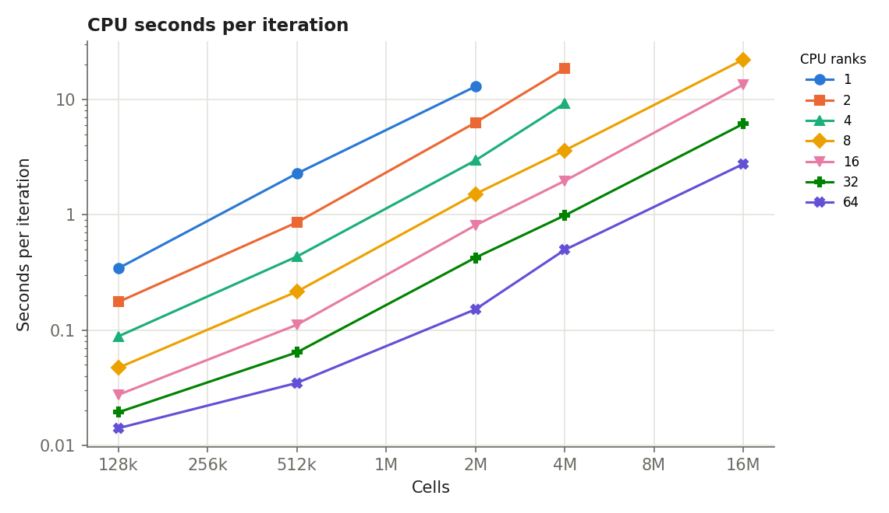
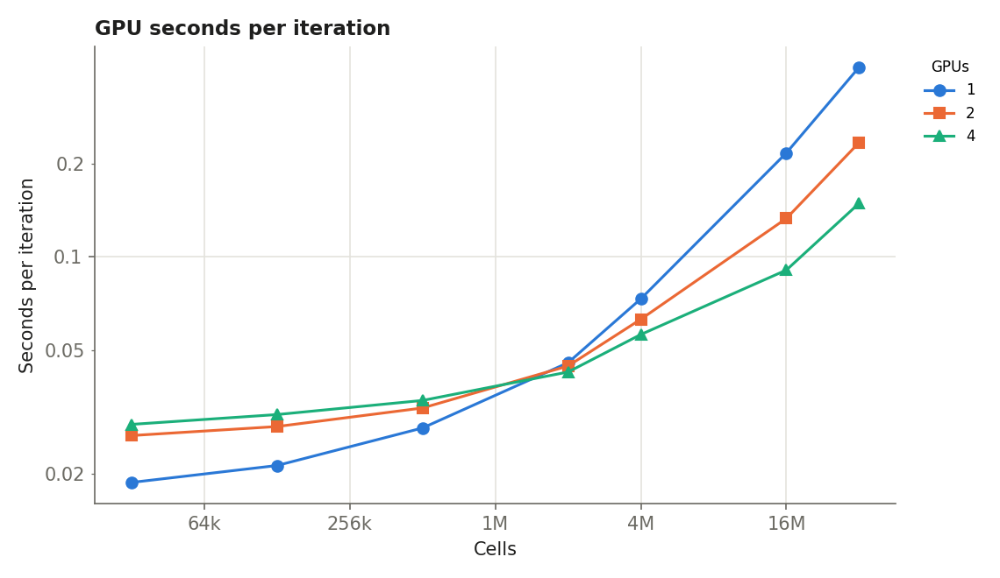
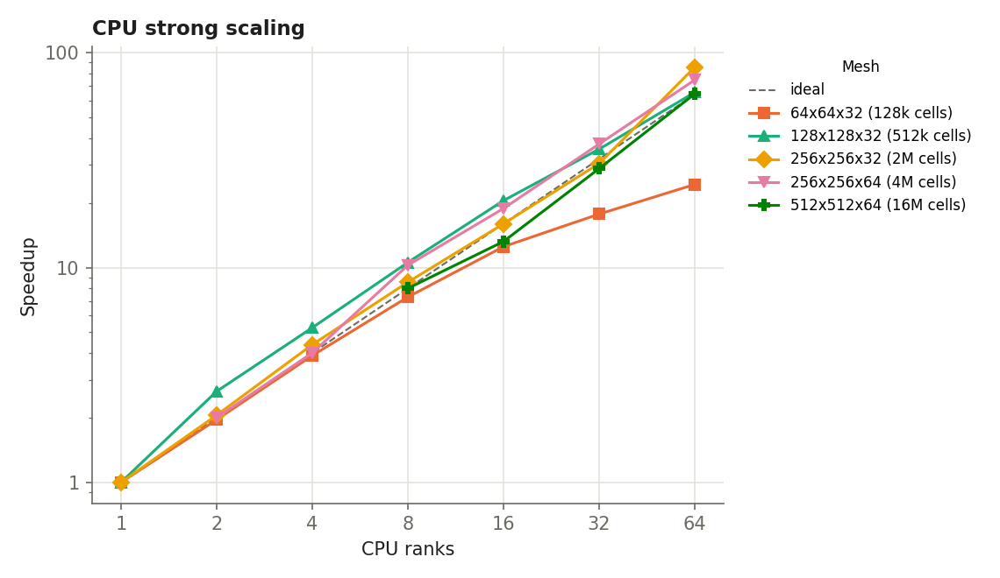
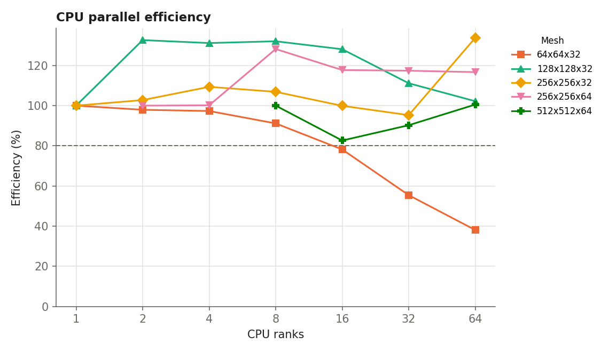
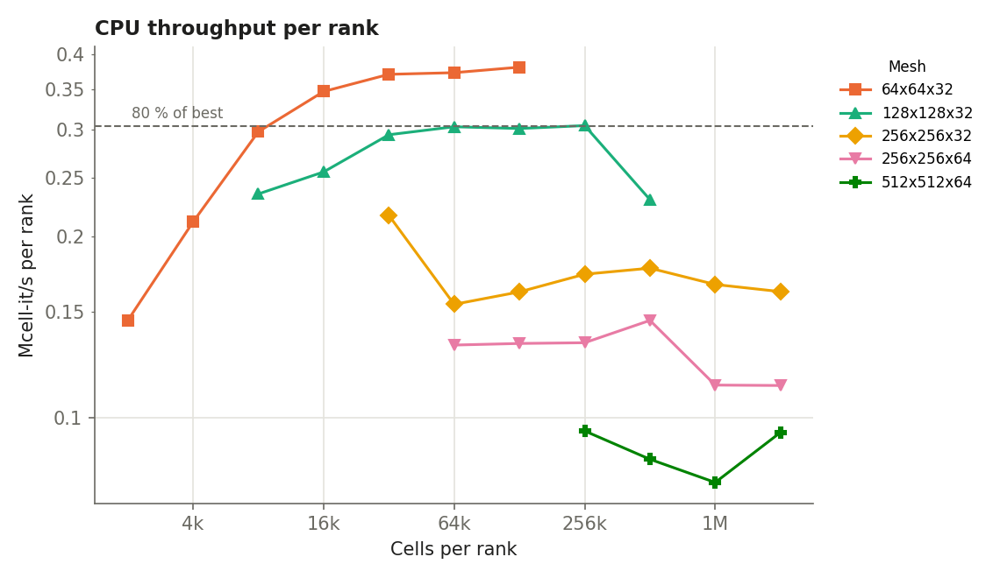
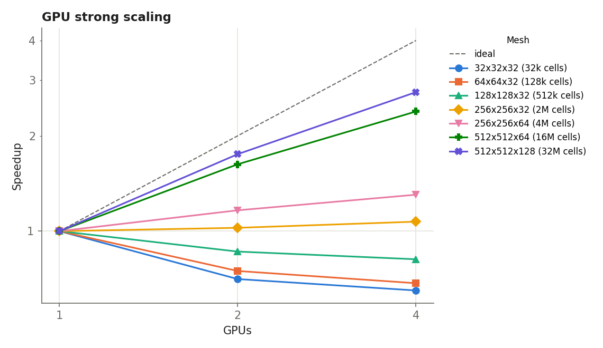
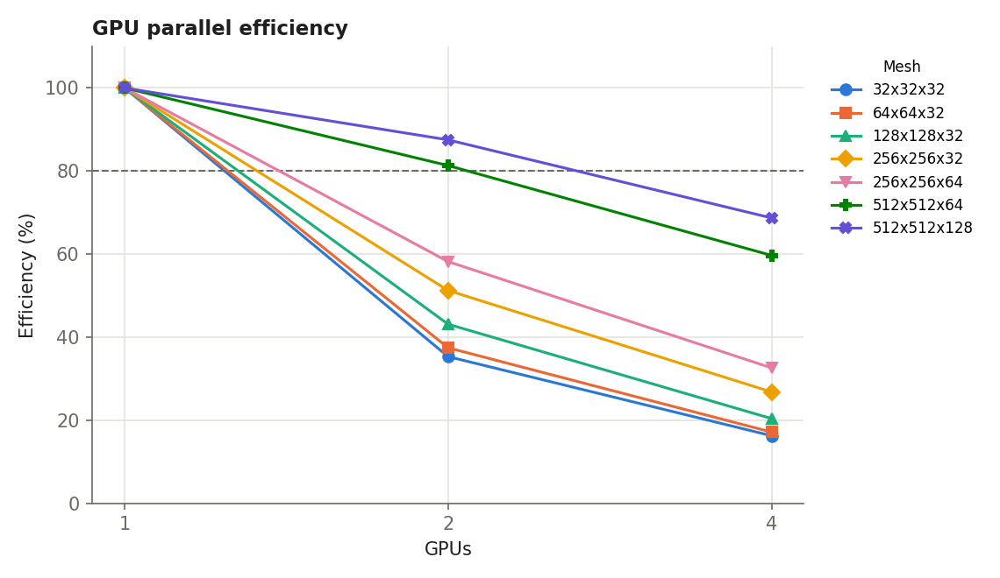
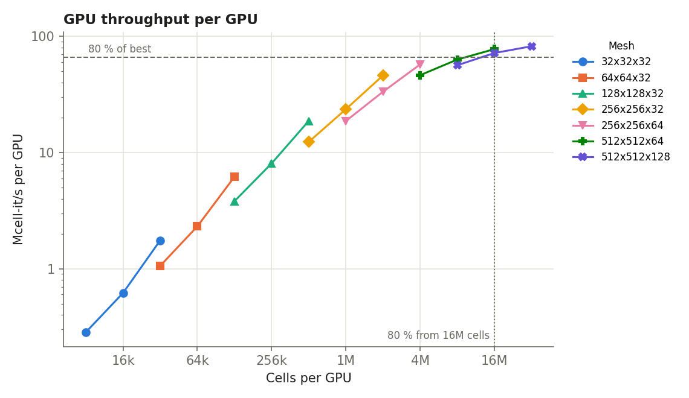
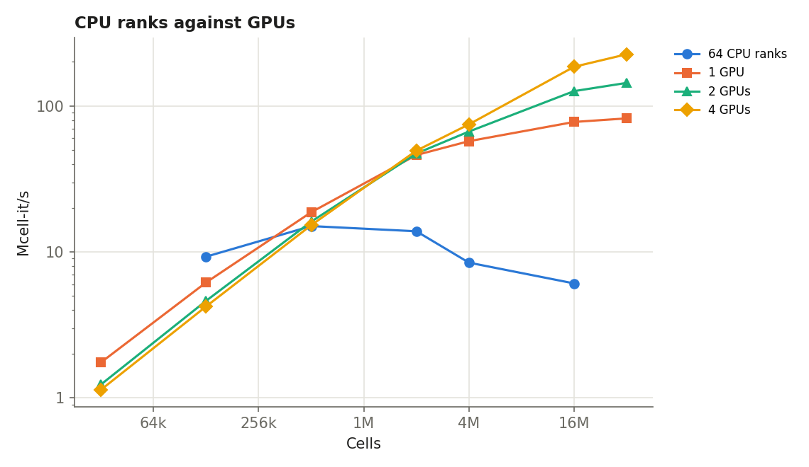
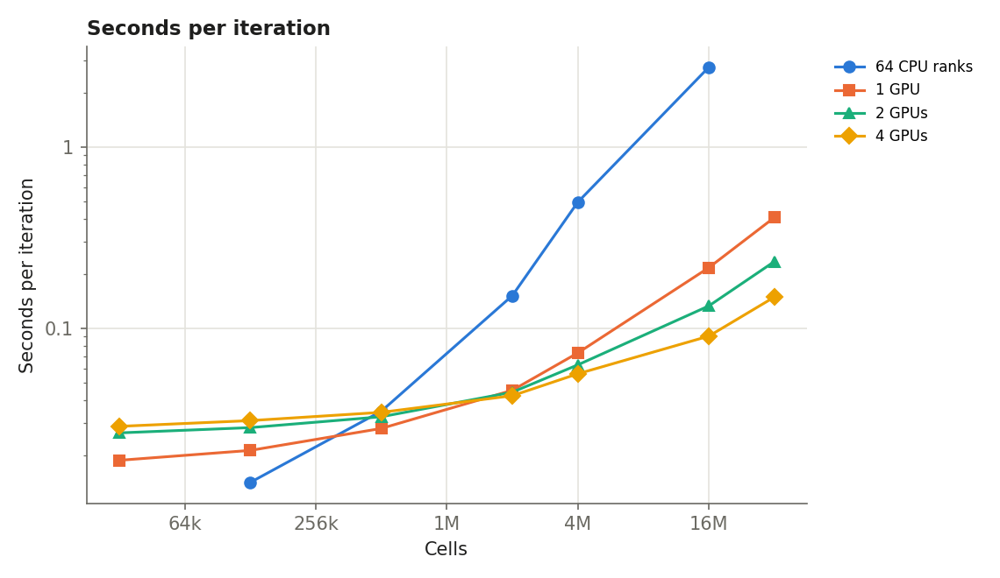

Performance and scaling
=======================

Strong scaling of GUST: CPU runs on 1 to 64 MPI ranks of a Kestrel CPU node (104 Intel Xeon Sapphire Rapids cores), and GPU runs on 1, 2 and 4 GPUs of a Kestrel GPU node (4 × NVIDIA H100), one rank per GPU. GUST 12a81339f on x1002c0s0b0n0, x3109c0s33b0n0.

Set-up
------

.. list-table::
   :header-rows: 1
   :widths: 20 80

   * - Item
     - Value
   * - Case
     - ``Tests/Canonical_RANS/Neutral_Hill_3D/inputs_steady_hill3d``: the 3-D Agnesi hill, periodic, Coriolis on, z-line Jacobi sweeps on both devices; no plotfiles or checkpoints written
   * - Meshes
     - 32x32x32, 64x64x32, 128x128x32, 256x256x32, 256x256x64, 512x512x64, 512x512x128
   * - Boxes
     - one per rank: x and y split in powers of 2 (``mesh.max_grid_size``), whole columns in z
   * - Launch
     - CPU ``srun --cpu-bind=cores``; GPU ``srun --gpus-per-task=1 --gpu-bind=none``
   * - Timing
     - seconds per iteration from the difference of a 10- and a 40-iteration run, using the solver's stage time (``gust: stage account``); set-up, the first guess and CUDA start-up are left out
   * - Throughput
     - cell-iterations per second (cells / seconds per iteration), in millions (Mcell-it/s); per rank or per GPU, divided by the count

Minimum cells per rank and per GPU
----------------------------------

The smallest load from which on every measured point keeps 80 % (50 %) of the best per-rank (per-GPU) throughput. "Levelled off" says whether the largest load gains less than 5 % over the next; if not, the best throughput is not yet reached and a larger mesh is needed.

.. list-table::
   :header-rows: 1
   :widths: 24 8 14 18 18 18

   * - Device
     - Points
     - Best Mcell-it/s per device
     - 80 % from (cells)
     - 50 % from (cells)
     - Levelled off
   * - CPU, all rank counts
     - 31
     - 0.381
     - not reached
     - not reached
     - yes (-3 % at the largest load)
   * - CPU, 64 ranks (most measured)
     - 5
     - 0.235
     - not reached
     - not reached
     - yes (-28 % at the largest load)
   * - GPU, 1 GPU
     - 7
     - 82.1
     - 16M (16777216)
     - 2M (2097152)
     - no (+6 % at the largest load): add a larger mesh
   * - GPU, 2 GPUs
     - 7
     - 71.8
     - 8M (8388608)
     - 8M (8388608)
     - no (+14 % at the largest load): add a larger mesh
   * - GPU, 4 GPUs
     - 7
     - 56.4
     - 4M (4194304)
     - 4M (4194304)
     - no (+22 % at the largest load): add a larger mesh
   * - GPU, all GPU counts
     - 21
     - 82.1
     - 16M (16777216)
     - 4M (4194304)
     - no (+6 % at the largest load): add a larger mesh

On the CPU the per-rank throughput also falls as ranks share the node's memory bandwidth, so the all-rank-count row mixes that with the box size; the row with the most ranks is the closest to a full node.

CPU runs
--------

.. list-table::
   :header-rows: 1
   :widths: 12 10 7 7 10 10 10 10 8 8

   * - Mesh
     - Cells
     - CPU ranks
     - Boxes
     - Cells per rank
     - s per iteration
     - Mcell-it/s
     - per rank
     - Speedup
     - Efficiency
   * - 64x64x32
     - 131072
     - 1
     - 1x1
     - 131072
     - 0.3442
     - 0.381
     - 0.381
     - 1
     - 100 %
   * - 64x64x32
     - 131072
     - 2
     - 2x1
     - 65536
     - 0.1758
     - 0.746
     - 0.373
     - 1.96
     - 98 %
   * - 64x64x32
     - 131072
     - 4
     - 2x2
     - 32768
     - 0.08843
     - 1.48
     - 0.371
     - 3.89
     - 97 %
   * - 64x64x32
     - 131072
     - 8
     - 4x2
     - 16384
     - 0.04721
     - 2.78
     - 0.347
     - 7.29
     - 91 %
   * - 64x64x32
     - 131072
     - 16
     - 4x4
     - 8192
     - 0.02752
     - 4.76
     - 0.298
     - 12.5
     - 78 %
   * - 64x64x32
     - 131072
     - 32
     - 8x4
     - 4096
     - 0.01941
     - 6.75
     - 0.211
     - 17.7
     - 55 %
   * - 64x64x32
     - 131072
     - 64
     - 8x8
     - 2048
     - 0.01413
     - 9.28
     - 0.145
     - 24.4
     - 38 %
   * - 128x128x32
     - 524288
     - 1
     - 1x1
     - 524288
     - 2.282
     - 0.23
     - 0.23
     - 1
     - 100 %
   * - 128x128x32
     - 524288
     - 2
     - 2x1
     - 262144
     - 0.8602
     - 0.609
     - 0.305
     - 2.65
     - 133 %
   * - 128x128x32
     - 524288
     - 4
     - 2x2
     - 131072
     - 0.4349
     - 1.21
     - 0.301
     - 5.25
     - 131 %
   * - 128x128x32
     - 524288
     - 8
     - 4x2
     - 65536
     - 0.216
     - 2.43
     - 0.303
     - 10.6
     - 132 %
   * - 128x128x32
     - 524288
     - 16
     - 4x4
     - 32768
     - 0.1113
     - 4.71
     - 0.294
     - 20.5
     - 128 %
   * - 128x128x32
     - 524288
     - 32
     - 8x4
     - 16384
     - 0.06416
     - 8.17
     - 0.255
     - 35.6
     - 111 %
   * - 128x128x32
     - 524288
     - 64
     - 8x8
     - 8192
     - 0.03489
     - 15
     - 0.235
     - 65.4
     - 102 %
   * - 256x256x32
     - 2097152
     - 1
     - 1x1
     - 2097152
     - 12.96
     - 0.162
     - 0.162
     - 1
     - 100 %
   * - 256x256x32
     - 2097152
     - 2
     - 2x1
     - 1048576
     - 6.307
     - 0.332
     - 0.166
     - 2.06
     - 103 %
   * - 256x256x32
     - 2097152
     - 4
     - 2x2
     - 524288
     - 2.963
     - 0.708
     - 0.177
     - 4.37
     - 109 %
   * - 256x256x32
     - 2097152
     - 8
     - 4x2
     - 262144
     - 1.516
     - 1.38
     - 0.173
     - 8.55
     - 107 %
   * - 256x256x32
     - 2097152
     - 16
     - 4x4
     - 131072
     - 0.811
     - 2.59
     - 0.162
     - 16
     - 100 %
   * - 256x256x32
     - 2097152
     - 32
     - 8x4
     - 65536
     - 0.4252
     - 4.93
     - 0.154
     - 30.5
     - 95 %
   * - 256x256x32
     - 2097152
     - 64
     - 8x8
     - 32768
     - 0.1514
     - 13.8
     - 0.216
     - 85.6
     - 134 %
   * - 256x256x64
     - 4194304
     - 2
     - 2x1
     - 2097152
     - 18.54
     - 0.226
     - 0.113
     - 2
     - 100 %
   * - 256x256x64
     - 4194304
     - 4
     - 2x2
     - 1048576
     - 9.256
     - 0.453
     - 0.113
     - 4.01
     - 100 %
   * - 256x256x64
     - 4194304
     - 8
     - 4x2
     - 524288
     - 3.617
     - 1.16
     - 0.145
     - 10.3
     - 128 %
   * - 256x256x64
     - 4194304
     - 16
     - 4x4
     - 262144
     - 1.969
     - 2.13
     - 0.133
     - 18.8
     - 118 %
   * - 256x256x64
     - 4194304
     - 32
     - 8x4
     - 131072
     - 0.9872
     - 4.25
     - 0.133
     - 37.6
     - 117 %
   * - 256x256x64
     - 4194304
     - 64
     - 8x8
     - 65536
     - 0.4966
     - 8.45
     - 0.132
     - 74.7
     - 117 %
   * - 512x512x64
     - 16777216
     - 8
     - 4x2
     - 2097152
     - 22.17
     - 0.757
     - 0.0946
     - 8
     - 100 %
   * - 512x512x64
     - 16777216
     - 16
     - 4x4
     - 1048576
     - 13.42
     - 1.25
     - 0.0781
     - 13.2
     - 83 %
   * - 512x512x64
     - 16777216
     - 32
     - 8x4
     - 524288
     - 6.142
     - 2.73
     - 0.0854
     - 28.9
     - 90 %
   * - 512x512x64
     - 16777216
     - 64
     - 8x8
     - 262144
     - 2.757
     - 6.09
     - 0.0951
     - 64.3
     - 101 %

Speedup and efficiency against the smallest CPU rank count measured for each mesh.

GPU runs
--------

.. list-table::
   :header-rows: 1
   :widths: 12 10 7 7 10 10 10 10 8 8

   * - Mesh
     - Cells
     - GPUs
     - Boxes
     - Cells per GPU
     - s per iteration
     - Mcell-it/s
     - per GPU
     - Speedup
     - Efficiency
   * - 32x32x32
     - 32768
     - 1
     - 1x1
     - 32768
     - 0.01871
     - 1.75
     - 1.75
     - 1
     - 100 %
   * - 32x32x32
     - 32768
     - 2
     - 2x1
     - 16384
     - 0.02651
     - 1.24
     - 0.618
     - 0.706
     - 35 %
   * - 32x32x32
     - 32768
     - 4
     - 2x2
     - 8192
     - 0.0288
     - 1.14
     - 0.284
     - 0.65
     - 16 %
   * - 64x64x32
     - 131072
     - 1
     - 1x1
     - 131072
     - 0.02122
     - 6.18
     - 6.18
     - 1
     - 100 %
   * - 64x64x32
     - 131072
     - 2
     - 2x1
     - 65536
     - 0.02834
     - 4.62
     - 2.31
     - 0.749
     - 37 %
   * - 64x64x32
     - 131072
     - 4
     - 2x2
     - 32768
     - 0.03098
     - 4.23
     - 1.06
     - 0.685
     - 17 %
   * - 128x128x32
     - 524288
     - 1
     - 1x1
     - 524288
     - 0.02804
     - 18.7
     - 18.7
     - 1
     - 100 %
   * - 128x128x32
     - 524288
     - 2
     - 2x1
     - 262144
     - 0.03253
     - 16.1
     - 8.06
     - 0.862
     - 43 %
   * - 128x128x32
     - 524288
     - 4
     - 2x2
     - 131072
     - 0.0344
     - 15.2
     - 3.81
     - 0.815
     - 20 %
   * - 256x256x32
     - 2097152
     - 1
     - 1x1
     - 2097152
     - 0.04553
     - 46.1
     - 46.1
     - 1
     - 100 %
   * - 256x256x32
     - 2097152
     - 2
     - 2x1
     - 1048576
     - 0.04444
     - 47.2
     - 23.6
     - 1.02
     - 51 %
   * - 256x256x32
     - 2097152
     - 4
     - 2x2
     - 524288
     - 0.04249
     - 49.4
     - 12.3
     - 1.07
     - 27 %
   * - 256x256x64
     - 4194304
     - 1
     - 1x1
     - 4194304
     - 0.07317
     - 57.3
     - 57.3
     - 1
     - 100 %
   * - 256x256x64
     - 4194304
     - 2
     - 2x1
     - 2097152
     - 0.06288
     - 66.7
     - 33.4
     - 1.16
     - 58 %
   * - 256x256x64
     - 4194304
     - 4
     - 2x2
     - 1048576
     - 0.05614
     - 74.7
     - 18.7
     - 1.3
     - 33 %
   * - 512x512x64
     - 16777216
     - 1
     - 1x1
     - 16777216
     - 0.2162
     - 77.6
     - 77.6
     - 1
     - 100 %
   * - 512x512x64
     - 16777216
     - 2
     - 2x1
     - 8388608
     - 0.1329
     - 126
     - 63.1
     - 1.63
     - 81 %
   * - 512x512x64
     - 16777216
     - 4
     - 2x2
     - 4194304
     - 0.09058
     - 185
     - 46.3
     - 2.39
     - 60 %
   * - 512x512x128
     - 33554432
     - 1
     - 1x1
     - 33554432
     - 0.4087
     - 82.1
     - 82.1
     - 1
     - 100 %
   * - 512x512x128
     - 33554432
     - 2
     - 2x1
     - 16777216
     - 0.2336
     - 144
     - 71.8
     - 1.75
     - 87 %
   * - 512x512x128
     - 33554432
     - 4
     - 2x2
     - 8388608
     - 0.1488
     - 226
     - 56.4
     - 2.75
     - 69 %

Speedup and efficiency against the smallest GPU count measured for each mesh.

Plots
-----

   CPU seconds per iteration against mesh size, one line per rank count.

   GPU seconds per iteration against mesh size, one line per GPU count.

   CPU strong scaling: speedup against the smallest rank count of each mesh.

   CPU parallel efficiency.

   CPU throughput per rank against cells per rank.

   GPU strong scaling: speedup against one GPU.

   GPU parallel efficiency.

   GPU throughput per GPU against cells per GPU.

   The most CPU ranks measured against 1, 2 and 4 GPUs, total throughput.

   Seconds per iteration against mesh size, the most CPU ranks measured and 1, 2 and 4 GPUs.

Reproducing
-----------

``run_scaling.sh`` (in a one-node allocation; ``CPU_TARGET=spr`` on a CPU node) builds GUST for CPU and CUDA, runs every point and writes ``results.csv``; ``analyze_scaling.py results.csv`` writes the plots, this page and the README section. Finished points are skipped when the script runs again. The measured ``results.csv`` and ``analyze_scaling.py`` are in ``tools/scaling/``; ``run_scaling.sh`` is not in the repository yet.
